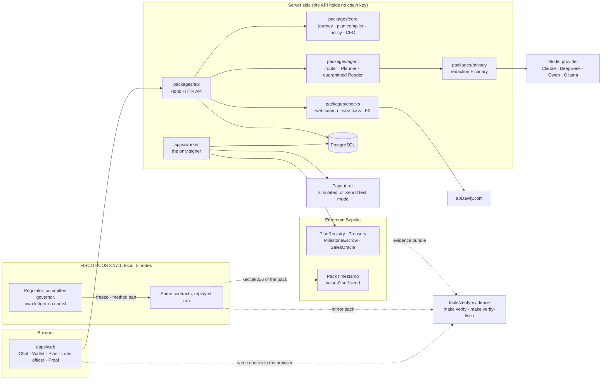

# Hogee

**An agent wallet that makes running a small business easier, for first-time and experienced owners alike. The owner
signs the business plan once with a passkey; the plan becomes the on-chain policy their AI agent spends under.**

Hogee (short for *Hogiak*, 好額, Hokkien for "rich") is Team FEIN's entry in the 2026 FinTechathon, International AI
Track, Topic F (Agent Wallet).

[Docs index](docs/README.md) · [Technical document](docs/submission/TECH-DOC.md) ·
[Security self-assessment](docs/submission/SECURITY-SELF-ASSESSMENT.md) ·
[Execution evidence](docs/submission/EXECUTION-EVIDENCE.md) · [FISCO BCOS mirror](docs/fisco/README.md) ·
[MIT license](LICENSE)

| At a glance | |
|---|---|
| **On a public chain** | Two deployments of the same contracts on Ethereum Sepolia. Mei's chat run: 11 transactions. The red-team run: 77 transactions, 45 cases pass, 0 fail, 2 not run (section 5 says why). |
| **A regulator with chain-level powers** | A FISCO BCOS mirror with three independent stops on the same spend: two by the regulator at chain level (account freeze, method ban) and one by the loan officer in Hogee's contract (pause). The mirror pack carries a public Sepolia timestamp. |
| **Proof you can re-run offline** | `make verify` re-checks a Sepolia evidence bundle and `make verify-fisco` runs 18 checks on the FISCO pack. Neither needs a network, a wallet or a key. |
| **Tested** | 553 Foundry tests, 5,517 Vitest tests in 15 packages, 158 Playwright smoke tests and one full chat-journey test (commit `927851d`). |

---

## 1. Project overview

- **Track:** International AI Track, Topic F (Agent Wallet: Autonomous On-chain Wallet)
- **Team name:** Team FEIN
- **Project name:** Hogee
- **One-line summary:** One AI chat helps run a small business on a loan or grant budget: the owner signs the plan
  on-chain, and an agent wallet pays on its own, only inside the caps they signed.

### The problem

Running a small business on a loan or grant takes work beyond the product itself, whether it is the owner's first
business or one they have run for years. The local rules (registration, GST, import tax) differ by country, so a
budget can miss whole costs. Suppliers are often strangers, and paying one is a risk. And the lender cannot watch every
payment. A first-time founder may not know the rules yet; an experienced owner knows them but has little time to check
every payment and every supplier. Agent wallets can now pay on their own, but in many of them the spending rules live
in a prompt, where one injected message can change them.

### What Hogee does

Hogee lays out what the business needs and where each rule comes from, checks suppliers, makes the routine payments and
reports on the money, while every payment stays inside rules the owner signed. A first-time founder learns what the
business needs; an experienced owner hands over the routine work and keeps control of the rules. (In the app and the
contracts, the person running the business is called the founder.)

The demo follows Mei, a first-time founder in Singapore (a synthetic persona), with a SGD 10,000 micro-loan, held as
**10,000 budget units (BU)**, to sell insulated tumblers on Shopee Singapore. Mei runs the business from one chat:

1. **Needs.** Mei answers two or three questions. The AI shows what the business needs (registrations, budget lines,
   suppliers to find, the tax reserve), each item with its source. Mei signs it as one on-chain plan with a passkey.
2. **Suppliers.** Hogee searches listing sites and reads each page in quarantine. Code checks and scores the pages;
   a page flagged for instructions aimed at the AI is excluded, and the card says why. A web supplier stays an
   "Unverified web supplier".
3. **Terms.** Mei contacts the supplier directly; Hogee never messages anyone. Mei reports the deal ("went with #2, 30%
   deposit, 70% on delivery"), enters the payout account in a form, and signs the schedule.
4. **The wallet pays.** After a cooling period, during which the loan officer can stop it, the agent pays the deposit by
   itself. The balance waits for Mei's delivery check and signature.
5. **AI CFO.** "How are we doing?" shows spending, sales, the tax reserve, profit and a forecast. On a burn alert the
   agent tightens a cap by itself and shows the transaction.

The models propose, `packages/core` decides, the contracts enforce. The agent may pay bound payees within caps, fund
pre-signed milestones and tighten. It cannot loosen a rule, sign as the founder or spend the tax reserve. Every
loosening needs the founder, the loan officer and a timelock.

BU are an internal ledger unit: not transferable, not pegged, not redeemable. Payouts in the demo are simulated. In
production a licensed partner bank holds the money and the chain is the rule and audit layer.

### Quick look: mock mode, no keys, no chain

Needs Node 24.

```bash
corepack enable                       # pnpm 12.11.2, pinned in package.json
pnpm install --frozen-lockfile
pnpm --filter @hogee/web dev:mock     # serves http://localhost:3000
```

| Open | What you see |
|---|---|
| http://localhost:3000/chat | The chat (home), on the labelled Sample business: Mei about three weeks in |
| http://localhost:3000/dashboard | Wallet: spending, sales, profit, forecast and the tax reserve |
| http://localhost:3000/plan | The signed plan: pockets, rules, releases and the signature |
| http://localhost:3000/evidence | Proof → Checks: the evidence bundles and the FISCO mirror pack, checked again in your browser, with the pack's Sepolia timestamp |
| http://localhost:3000/timeline | Proof → Activity record |
| http://localhost:3000/officer | The loan officer's console. The terminal prints a one-run access code: open the quick settings (top right), choose **View as → Loan officer** and type it |

Use `localhost`, not `127.0.0.1`, or passkeys will not work. The mock simulates the chain and labels its sample data.
`MOCK_SCENARIO=fresh pnpm --filter @hogee/web dev:mock` starts Mei's chat journey from an empty facility instead.

## 2. System architecture



| Component | Role |
|---|---|
| `apps/web` | Next.js UI. The chat is home; Wallet, Plan, Suppliers, Loan officer and Proof are detail views. One catch-all route mounts the live API, the mock API (`MOCK_API=1`) or an offline replay (`REPLAY=<runId>`). |
| `packages/api` | The live backend (Hono). It holds no chain (signing) key. It runs the chat journey, the web search, the terms checks and the CFO report, and writes jobs for the worker. |
| `packages/api-contract`, `packages/api-mock` | Every route as a zod schema. The mock serves the same routes from fixtures, and both pass the same contract tests. |
| `packages/agent` | The model registry, the chat router (it picks one of 8 skills and nothing else), the Planner and the quarantined Reader, which has no tools. Model text is never shown to the founder. |
| `packages/core` | Pure code: the journey, `buildNeeds`, terms to schedule, the CFO report, the plan compiler, the policy engine, the supplier scorer and the hashing. |
| `packages/checks` | The web search client (one fixed host, no redirects), the listing allow-list, UN sanctions screening, registry id checks and FX. |
| `packages/privacy` | PII redaction before every model call, with a canary that blocks the call if redaction fails. |
| `packages/chain`, `packages/db` | viem clients, ABIs, the nonce allocator and the passkey and EIP-712 helpers; the Drizzle schema and migrations. |
| `apps/worker` | The only process that signs: the agent's payments, relays of signed approvals, settlement, timelocks and the `cfo-guard` job, which can only tighten. |
| `apps/mcp` | An MCP server with 5 tools over the HTTP API. It never touches the chain. |
| `contracts/` | Foundry: `PlanRegistry`, `Treasury` with its `TreasuryGovernance` module, `MilestoneEscrow`, `SalesOracle`. |
| `tools/verify-evidence` | The offline checker behind `make verify` and `make verify-fisco`; the Proof page runs the same code in the browser. |
| `scripts/redteam`, `scripts/fisco` | The red-team runner and the FISCO BCOS chain, replay and anchor scripts. |
| Data sources | `data/country-packs/`: the Singapore and Malaysia facts, each with its source URL, retrieval date and snippet hash (tier RESEARCHED: no fact is signed off by a person yet). `data/sanctions/un_sc.csv`: the UN Security Council consolidated list. `data/suppliers/search/`: the recorded web search sample and its page readings. `data/suppliers/`: the demo supplier catalog. Live lookups: Tavily search (only with a key), GLEIF and Bank Negara Malaysia FX. |

Web text reaches only the quarantined Reader and never the wallet. The search query is built from the signed plan, and
result URLs are never fetched. More detail: [Technical document](docs/submission/TECH-DOC.md).

## 3. Environment and dependencies

- **Operating system:** macOS (developed on macOS) or Linux (CI runs on Ubuntu). Windows is not a supported target;
  the dev-live and FISCO scripts are macOS/Linux only, and the FISCO BCOS scripts need macOS (Apple silicon binary,
  macOS sandbox profiles).
- **Runtime versions:** Node 24 (`.nvmrc`; `engines` allows ≥ 22.12), pnpm 12.11.2 (`packageManager`), TypeScript
  6.0.3, Foundry 1.8.5 with solc 0.8.37 (`evm_version = "cancun"`), PostgreSQL 16, FISCO BCOS 3.17.1 (mirror only).
- **Main dependencies:** Next.js 16.4, React 19.3, Hono 4.13, zod 4.6, viem 2.57, AI SDK 7, pg-boss 12, Drizzle ORM,
  Vitest 5, Playwright 1.64, OpenZeppelin Contracts 5.7.0 (Soldeer). Full pins: [docs/VERSIONS.md](docs/VERSIONS.md).
- **Environment variables:** never commit real secrets or sensitive data. Keep them in a local, git-ignored environment
  file. The gitleaks pre-commit hook blocks a commit that contains a key gitleaks detects, and CI runs gitleaks again on every pull
  request and every push to `main`. The mock mode, `pnpm dev:live` and `make verify` need **no** secrets: they
  generate per-run values or use none.

| Group | Main variables (values are never committed) |
|---|---|
| Chain | `CHAIN` (`local`, `sepolia`), `SEPOLIA_RPC_URL`, `DEPLOYMENT_ID` |
| Worker keys (worker host only) | `AGENT_PRIVATE_KEY_FINAL`, `ORACLE_PRIVATE_KEY_FINAL`, `LENDER_PRIVATE_KEY_FINAL`, `RELAYER_PRIVATE_KEY_FINAL` |
| Models | `MODEL_PROVIDER` (`anthropic`, `deepseek`, `qwen`, `ollama`), `ANTHROPIC_API_KEY`, `DEEPSEEK_API_KEY`, `DASHSCOPE_API_KEY`, `OLLAMA_BASE_URL` |
| Web search | `TAVILY_API_KEY` (optional; without it the search serves a labelled recorded sample) |
| Payout rail | `PAYOUT_RAIL` (`mock`, `xendit`), `XENDIT_SECRET_KEY`, `STRIPE_SECRET_KEY`, `STRIPE_WEBHOOK_SECRET` (test mode only) |
| App | `DATABASE_URL`, `MOCK_API`, `MOCK_SCENARIO`, `REPLAY`, `DEMO_MODE`, `DEMO_TIMELOCK_SECONDS`, `HOGEE_COUNTRY` (`SG`, `MY`), `PERSONA_COOKIE_SECRET`, `HOGEE_ALLOWED_HOSTS`, `OFFICER_TOKEN` (the officer access code) |
| Checker (optional) | `HOGEE_VERIFY_RPC`, `HOGEE_ANCHOR_RPC`: a Sepolia RPC URL for the online comparison |

## 4. Installation and execution

**Prerequisites.** Node 24 and pnpm 12.11.2 for everything. Foundry (`~/.foundry/bin`, from https://getfoundry.sh) for
the contracts, the red team and the local live stack. PostgreSQL 16 binaries for the live stack, the live API tests and
the red team. gitleaks only if you commit (the pre-commit hook needs it).

**Clean setup**

```bash
git clone https://github.com/Khaosphires/hogee-agent-wallet.git hogee && cd hogee
nvm use                                                   # Node 24, from .nvmrc
corepack enable                                           # pnpm 12.11.2
pnpm install --frozen-lockfile                            # also points git at .githooks (gitleaks pre-commit)
(cd contracts && ~/.foundry/bin/forge soldeer install)    # Solidity dependencies; only for contract work
```

**Option A: mock demo (no keys, no chain).** See [Quick look](#quick-look-mock-mode-no-keys-no-chain).
`REPLAY=ev-cdc4cc7916471c1e pnpm --filter @hogee/web dev:mock` replays Mei's recorded local run instead, with no
network.

**Option B: the live stack on a local chain.**

```bash
pnpm dev:live -- --fresh       # options: --country SG|MY, --seed-sales <days>, --prod
```

It starts Anvil and deploys `final-1`, starts a throwaway Postgres, the worker and the web app with the live API, opens
the facility (10,000 BU) and prints the URLs and the officer access code. It does not use your `PATH`. Its children get a
fixed one: the launcher's own Node folder, then `~/.foundry/bin`, `/opt/homebrew/bin`,
`/opt/homebrew/opt/postgresql@16/bin`, `/usr/local/bin`, `/usr/lib/postgresql/16/bin`, `/usr/bin` and `/bin`. Foundry
and PostgreSQL 16 must be installed in one of those. It sets no model provider on purpose, so `/api/health`
reports `llm: down`. It sets no search key either, so the supplier search serves the labelled recorded sample; but it
does not blank `TAVILY_API_KEY`, so a key in the web app's own local environment file would still be used. Nothing
touches Sepolia. Ctrl-C stops everything.

**Option C: Sepolia.** For maintainers with funded keys and an always-on worker host: see the
[Sepolia runbook](docs/submission/SEPOLIA-RUNBOOK.md).

## 5. Testing

Results below are for commit `927851d` (`main`, 20 Oct 2026).

| Command | What it runs | Result |
|---|---|---|
| `pnpm typecheck` | `tsc --noEmit` in every package | clean |
| `pnpm test` | Vitest tests in 15 packages | 5,517 passed, 0 failed |
| `cd contracts && ~/.foundry/bin/forge test` | Foundry unit, fuzz and invariant tests | 553 passed |
| `pnpm test:contract` | The mock API against the frozen route contract | 130 passed, 1 skipped |
| `pnpm validate:data` | Country packs, fixtures and recorded search files against the schemas | 146 ok |
| `pnpm gen:schemas:check` | Generated JSON Schemas are up to date | 31 up to date |
| `node scripts/lint-wording/index.mjs` | Banned-wording check on the UI, contracts, data and submission docs | 0 findings |
| `pnpm --filter @hogee/e2e e2e` | Playwright smoke at 1280×720 and 1920×1080, plus reset and Sample business runs | 158 passed, 4 skipped by design |
| `pnpm --filter @hogee/e2e journey` | Mei's whole chat journey on the fresh mock, then the whole conversation again at 320, 768, 1280 and 1920 px | 1 passed |

`make test` runs Foundry, typecheck and Vitest in one go; `make help` lists every target. The e2e suites need Playwright's Chromium.

<details>
<summary>Vitest tests per package</summary>

| Package | Tests | Package | Tests |
|---|---:|---|---:|
| `@hogee/core` | 1,393 | `@hogee/agent` | 253 |
| `@hogee/web` | 761 | `@hogee/verify-evidence` | 265 |
| `@hogee/api` | 619 | `@hogee/api-mock` | 233 |
| `@hogee/chain` | 367 | `@hogee/privacy` | 98 |
| `@hogee/checks` | 332 | `@hogee/dev-live` | 20 |
| `@hogee/api-contract` | 302 | `@hogee/mcp` | 12 |
| `@hogee/worker` | 293 | `@hogee/redteam` | 281 |
| `@hogee/db` | 288 | | |

</details>

**Live API tests** run one file at a time against your own Postgres and Anvil; they are not in the counts above:

```bash
TEST_DATABASE_URL=postgres://hogee@127.0.0.1:<pg-port>/hogee TEST_RPC_URL=http://127.0.0.1:<anvil-port> \
  pnpm --filter @hogee/api exec vitest run --fileParallelism=false test/live/<file>.live.test.ts
```

**The red team** (T1–T33 attacks, S1–S12 scripted tasks, two demos, plus WEB cases on a supplier found on the web)
runs on Anvil with `pnpm --filter @hogee/redteam start -- --rpc-url <anvil> --database-url <db>`. On Sepolia it ran
once on `final-1`; its results are in [the evidence section](#the-evidence-you-can-check) below. Each case and its pass
criteria: [Execution evidence](docs/submission/EXECUTION-EVIDENCE.md).

### The evidence you can check

Every Sepolia run is exported as an **evidence bundle**: raw signed transactions, receipts, signatures, plan hashes,
hash-chained traces and a `SUMMARY.md`. The checker needs no network:

```bash
make verify BUNDLE=evidence/ev-74756ea61a72ae7c                                           # Mei's chat run, final-2
make verify BUNDLE=evidence/rt-20261018t202130z-sepolia/export/main/ev-0f8e91d9eb2b2027   # red team, final-1
make verify-fisco PACK=evidence/fisco/fm-6abe83e663a2471b                                 # FISCO mirror, 18 checks
```

| Bundle | What it is | Contents |
|---|---|---|
| [`evidence/ev-74756ea61a72ae7c`](evidence/ev-74756ea61a72ae7c/SUMMARY.md) | Mei's chat run on Sepolia `final-2`, 19 Oct 2026, by hand in the web app with Mei's own passkey | 11 transactions, all successful; 3 passkey signatures |
| [`ev-0f8e91d9eb2b2027`](evidence/rt-20261018t202130z-sepolia/export/main/ev-0f8e91d9eb2b2027/SUMMARY.md) | The red team on Sepolia `final-1`, 18 to 19 Oct 2026 | 77 transactions; 45 pass, 0 fail, 2 not run: T22 by design (it needs blocks at ±1 s, which 12 s Sepolia slots cannot give), and T33 because that run's code had no query path to attack (its real case is the WEB variant on Anvil) |
| [`evidence/ev-cdc4cc7916471c1e`](evidence/ev-cdc4cc7916471c1e/SUMMARY.md) | Mei's run on a local Anvil chain, used by the offline replay demo | 24 receipts |
| [`evidence/fisco/fm-6abe83e663a2471b`](docs/fisco/README.md) | The FISCO BCOS mirror of the `final-2` run, with the regulator | 60 files, 37 steps, 38 transactions |

`VERIFIED` means a bundle is internally consistent: files, digests, signatures, commitments, calldata, events and plan
rules agree. It does not prove that Sepolia holds those transactions. For that, compare the anchor `make verify`
prints with Etherscan, or set `HOGEE_VERIFY_RPC=<your Sepolia RPC URL>` to compare every receipt and block with a
node. What each check covers: [Execution evidence](docs/submission/EXECUTION-EVIDENCE.md).

### Known limitations

- The web-injection defence is measured only for its model-free layer: it stops 8 of 20 blind-written attacks (40%,
  95% interval 21.9–61.3%). The Reader model's share and the chat router are not measured yet (no model key in the
  eval run). We quote no overall injection rate. Details: [docs/evals/journey.md](docs/evals/journey.md).
- Without a search key the supplier search serves a labelled recorded sample. Payouts run on a simulated rail.
- These red-team cases run on Anvil only: the WEB cases, the Singapore variants of T1 and T4, T15's `AgentExpired`
  variant (a 60-day clock jump), T16's API-side expiry probe and T22. Mei's Sepolia run has no sales and no CFO
  tighten; the red team covers both on `final-1`.
- The FISCO BCOS chain is local and not publicly reachable. Its block headers are taken as served. The Sepolia
  timestamp fixes the pack's content in time; its block and time are as the sidecar states them, and only Etherscan
  or `HOGEE_ANCHOR_RPC=<url> make verify-fisco` confirms them.
- No external audit, no formal verification, no mainnet.

## 6. Repository and deployment

- **GitHub / Git repository:** [https://github.com/Khaosphires/hogee-agent-wallet](https://github.com/Khaosphires/hogee-agent-wallet)
- **Live demo:** none hosted, by design (localhost only). The mock and the offline replay need no network, wallet or
  key.
- **Deployment instructions:** the [Sepolia runbook](docs/submission/SEPOLIA-RUNBOOK.md) gives the full order. In short:
  deploy with `contracts/script/DeployFinal.s.sol` from the lead's own keystore (no key on a command line), check the
  set with the read-only `contracts/script/VerifyFinal.s.sol`, verify the sources on Etherscan, write the manifest to
  `packages/chain/deployments/`. Then run the red team on `final-1` (it writes its own bundle), or the worker and the
  web app on `final-2` and export that bundle with `make evidence`.

### Sepolia deployments

Both use a 120 s payee cooling and a 120 s loosening timelock, labelled demo values; a production deploy would set 24 h.
All five `final-2` contracts show "Source Code Verified" on Sepolia Etherscan (checked by the team lead on 20 Oct 2026). Deploy
transactions: [Execution evidence](docs/submission/EXECUTION-EVIDENCE.md).

| Contract | `final-1`: red team | `final-2`: Mei's chat run |
|---|---|---|
| PlanRegistry | [`0xf33306d0F610a2B1F72c91D175Ed5d3BfA91710a`](https://sepolia.etherscan.io/address/0xf33306d0F610a2B1F72c91D175Ed5d3BfA91710a#code) | [`0x07289C8852f9780f5b5B7010BE7Fb68fCe159450`](https://sepolia.etherscan.io/address/0x07289C8852f9780f5b5B7010BE7Fb68fCe159450#code) |
| Treasury | [`0x8cEF590Ec00D02A33e8AC0FF56E67f20C53C6b22`](https://sepolia.etherscan.io/address/0x8cEF590Ec00D02A33e8AC0FF56E67f20C53C6b22#code) | [`0xE08872f9496d21053b52B1127AC30E87300564fa`](https://sepolia.etherscan.io/address/0xE08872f9496d21053b52B1127AC30E87300564fa#code) |
| TreasuryGovernance | [`0x79c11Ce431B37A23D833AA6a58c7B6fdB6bb21b4`](https://sepolia.etherscan.io/address/0x79c11Ce431B37A23D833AA6a58c7B6fdB6bb21b4#code) | [`0x322F48D1F770B2C73459b33848b49669B8dF3Df1`](https://sepolia.etherscan.io/address/0x322F48D1F770B2C73459b33848b49669B8dF3Df1#code) |
| MilestoneEscrow | [`0xa1D1b9BeFAfF3217c08a0fE0C24b014513B176a7`](https://sepolia.etherscan.io/address/0xa1D1b9BeFAfF3217c08a0fE0C24b014513B176a7#code) | [`0xa5222EBe0BE5CE769491F2f3396d14244d5d5761`](https://sepolia.etherscan.io/address/0xa5222EBe0BE5CE769491F2f3396d14244d5d5761#code) |
| SalesOracle | [`0x9eE722e2905aB76EaD5B10fB50B2778cc7dc152f`](https://sepolia.etherscan.io/address/0x9eE722e2905aB76EaD5B10fB50B2778cc7dc152f#code) | [`0x49FCFc043244A861da24DC16D19D3065732278E2`](https://sepolia.etherscan.io/address/0x49FCFc043244A861da24DC16D19D3065732278E2#code) |

### FISCO BCOS: a regulator with chain-level powers

The same contracts run on a local five-node FISCO BCOS 3.17.1 chain with permission checks on, and the `final-2` run
is replayed there with its refusals. A **regulator** account is the genesis committee's only governor and runs node4,
which keeps its own copy of the ledger. On the same agent payment (a `Treasury.spend` of 100 BU, byte-identical
calldata each time) there are three independent stops:

| Step | Who stops it | How | Result |
|---|---|---|---|
| F1 | The regulator, at chain level | Freezes the agent's account (`AccountManager`) | Refused by the chain: status 22, AccountFrozen |
| M1 | The regulator, at chain level | Bans `Treasury.spend` for the agent (`ContractAuth`) | Refused by the chain: status 18, PermissionDenied |
| R17 | The loan officer, at contract level | Hogee's own pause | Refused by the contract: `Paused` |

The pack [`evidence/fisco/fm-6abe83e663a2471b`](docs/fisco/README.md) records 37 steps and 38 transactions, with nine
refusals. `make verify-fisco` runs 18 checks on it offline. Among them: node4's copy of the ledger, the regulator's
powers, and the deployed code compared with Sepolia's and with the compiler output carried in the pack, or with your
own `contracts/out` build when present (immutables explained). A
one-character edit makes it fail.

**Public timestamp.** The hogee-deployer sent one value-0 Sepolia transaction whose input names the pack and the
keccak256 of its `hashes.json`:
[`0xd38cd129…6d5a`](https://sepolia.etherscan.io/tx/0xd38cd129ee4082117436f1f9fbef93bd72862eb5f26b7f6a15dee0c0d2d36d5a)
in block 11951818 (20 Oct 2026, 00:47:48 UTC), as the sidecar states them; Etherscan or
`HOGEE_ANCHOR_RPC=<url> make verify-fisco` confirms the block and time. On Etherscan, "View input as UTF-8" shows the
line.
`make verify-fisco` requires this anchor. How it works and what it does not prove: [docs/fisco/ANCHOR.md](docs/fisco/ANCHOR.md).

FISCO software runs only through `scripts/fisco/*`: the binary is checked against pinned digests, every node runs in a
macOS sandbox profile, and every listener is on 127.0.0.1. Details: [docs/fisco/README.md](docs/fisco/README.md).

## 7. Security notes

- **Permission tiers.** The agent alone may pay bound payees within caps, fund pre-signed milestones and tighten,
  including the AI CFO's own cap cuts. The founder's passkey signs the plan, each supplier approval and each escrow
  balance release. Every loosening (move budget between lines, add a payee, raise a cap, extend an expiry, unpause,
  withdraw the reserve) needs the founder, the loan officer and a timelock.
- **Chain-level controls.** On the FISCO mirror the regulator can freeze the agent's account or ban one method for it,
  beside the officer's contract-level pause (section 6).
- **Confirmation for sensitive operations.** The signing panel renders from the same canonical JSON as the EIP-712
  digest, and the browser recomputes the digest before the passkey prompt. The contracts verify the passkey signature
  on-chain (OpenZeppelin `WebAuthn`) and re-check every plan against the on-chain constitution, even a validly signed
  one.
- **Web results never reach the wallet.** Web search adds one outbound host (`api.tavily.com`), and result URLs are
  never fetched. The app also calls `api.gleif.org`, `www.bnm.gov.my` and the model provider, and, when configured,
  Stripe and Xendit in test mode and a Sepolia RPC. A payout account arrives only through the founder's form, and a web
  supplier can be paid automatically at most one deposit within the per-payment cap, after cooling.
- **Chat.** Buttons send structured actions that skip the model; each action id works once. Typed text goes to a router
  that can only pick one of 8 skills. No typed message can start a payment, write terms or sign.
- **Data handling.** Every prompt is redacted before any model call, and the call is blocked if redaction fails. All
  demo data, including the recorded web sample, is synthetic. Hogee gives rules information with sources and dates; the
  founder confirms with the agency.
- **Keys.** The API holds no chain (signing) key. The worker is the only signer, and its role keys live on the worker host only;
  a leaked agent key can still spend within the caps until the reconciler pauses (red-team case T29). Sepolia deploys
  and the FISCO anchor sign from a keystore with a password typed at the terminal. The FISCO replay takes its keys on
  file descriptor 3, never on a command line or in an environment. Accepted residual: while `replay.sh` decrypts the
  local regulator keystore, its password is briefly in `cast`'s environment
  ([run-12 re-check](docs/security-audit-run-12/recheck-run12-fixes.md)).
- **Audits.** Twelve internal audit runs; there was no external audit. All twelve runs were quick and source-only;
  runs 2 to 12 each covered one commit range of new work. Being source-only, no record could reach
  "confirmed", and none of the twelve recorded a confirmed finding. Each run's leads were fixed and re-checked, in a
  re-check file or in the next run. Reports for runs 3 to 12 are in `docs/security-audit-run-*` (latest: [run-12](docs/security-audit-run-12/REPORT.md) and
  [its re-check](docs/security-audit-run-12/recheck-run12-fixes.md)). Slither and Aderyn found no true positives in
  the contracts ([triage](docs/assurance/static-analysis-2026-10-18.md)).
- **Known risks.** The demo founder persona is not authenticated. An offline "VERIFIED" means internally consistent,
  not chain truth. A fake listing that names the attacker's own company passes the holder-name check; the deposit cap,
  cooling and the founder's release bound the loss.

Full threat model, controls, residual risks and the audit history:
[Security self-assessment](docs/submission/SECURITY-SELF-ASSESSMENT.md).

## Repository map

| Path | What is there |
|---|---|
| `apps/web`, `apps/worker`, `apps/mcp` | The web app (UI and API mount), the signing worker, the MCP server |
| `packages/` | `api`, `api-contract`, `api-mock`, `agent`, `core`, `checks`, `chain`, `db`, `privacy` |
| `contracts/` | Solidity sources, Foundry tests, deploy and verify scripts, the tracked Sepolia broadcasts |
| `tools/verify-evidence` | The offline evidence checker (`make verify`, `make verify-fisco`) |
| `scripts/` | `redteam` (attack runner and FISCO replay), `fisco` (chain, deploy, anchor), `dev-live` (local live stack), `lint-wording`, and small helpers |
| `data/`, `fixtures/` | Country packs for Singapore and Malaysia with sources, PII canaries, the sanctions list, JSON Schemas, demo fixtures |
| `evals/`, `e2e/` | Eval datasets and runners; Playwright smoke and journey tests |
| `evidence/` | The Sepolia evidence bundles, the local replay bundle and the FISCO mirror pack with its anchor |
| `docs/` | Submission documents, FISCO docs, security audit reports: see the [docs index](docs/README.md) |

## Team

**Team FEIN**: Eldridge Francesco Tan ([@Khaosphires](https://github.com/Khaosphires)), Gavin Lee
([@gvlee1001](https://github.com/gvlee1001)), Pan Violyn Bridzed ([@Pvio98](https://github.com/Pvio98)) and Clarissa
Amberlyn.

We build with AI coding assistants. People own and review the contracts' checks, the EIP-712 layout, nonce handling,
the policy table, key handling and every deploy ([engineering notes](docs/ENGINEERING_NOTES.md)).

## License

[MIT](LICENSE), © 2026 Team FEIN.
