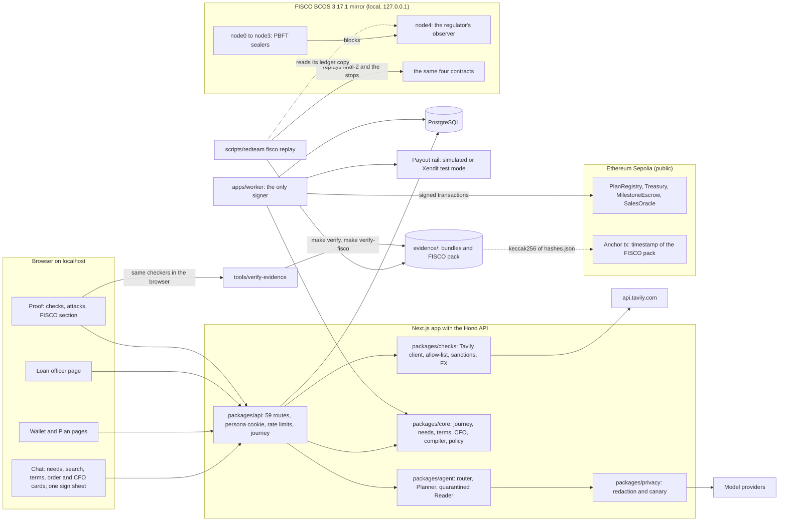

# Hogee: Technical Document

**2026 FinTechathon · International AI Track · Technical Document**

| Field | Value |
|---|---|
| Team name | Team FEIN |
| Competition track | International AI Track, Topic F (Agent Wallet: Autonomous On-chain Wallet) |
| Submission date | 20 Oct 2026 |
| Project | Hogee ("Hogiak", 好額, Hokkien for "rich") |
| Code described | `main` at commit `927851d` (20 Oct 2026) |
| Repository | [https://github.com/Khaosphires/hogee-agent-wallet](https://github.com/Khaosphires/hogee-agent-wallet) |

Related documents: [Security self-assessment](SECURITY-SELF-ASSESSMENT.md) · [Execution evidence](EXECUTION-EVIDENCE.md) · [Sepolia runbook](SEPOLIA-RUNBOOK.md) · [FISCO BCOS mirror](../fisco/README.md) · [Sepolia timestamp of the FISCO pack](../fisco/ANCHOR.md) · [Repository README](../../README.md)

**At a glance**

Hogee is an agent wallet, run from one AI chat, that makes running a small business easier for first-time and experienced owners alike. The founder (the person running the business) signs the business plan once with a passkey; the plan becomes an on-chain policy, and the AI agent pays suppliers and running costs only inside it. A loan officer can stop every agent payment. On a FISCO BCOS mirror of the same contracts, a regulator can also stop the agent at the chain level.

| What you can check | Where it is | How to check it |
|---|---|---|
| Mei's chat run on Sepolia (`final-2`): 11 transactions, 19 Oct 2026 | `evidence/ev-74756ea61a72ae7c` | `make verify BUNDLE=evidence/ev-74756ea61a72ae7c` |
| The red team on Sepolia (`final-1`): 45 pass, 0 fail, 2 not run (T22 by design; T33 had no query path on that code); 77 transactions | `evidence/rt-20261018t202130z-sepolia/export/main/ev-0f8e91d9eb2b2027` | `make verify BUNDLE=<that folder>` |
| The FISCO BCOS mirror with the regulator: 37 steps, 38 transactions, 9 refusals | `evidence/fisco/fm-6abe83e663a2471b` | `make verify-fisco PACK=evidence/fisco/fm-6abe83e663a2471b` (18 checks) |
| The public Sepolia timestamp of that pack | tx [`0xd38cd129…6d5a`](https://sepolia.etherscan.io/tx/0xd38cd129ee4082117436f1f9fbef93bd72862eb5f26b7f6a15dee0c0d2d36d5a), block 11951818 | part of `make verify-fisco`; Etherscan, "View input as UTF-8" |

All four checks run offline. The red team's own export, `ev-fdea4bd7118e7551`, fails one check (a fee-bumped `pause()` row kept the unmined bump's bytes); `ev-0f8e91d9eb2b2027` is its re-export after that row was repaired from the chain, and both are kept. §05 explains each check and what "VERIFIED" does and does not prove.

---

## 01 Project Overview

### Problem, target users and selected topic

A small business on a loan or grant faces three problems, whether it is the owner's first business or not. The local rules (business registration, GST, import tax, product approvals) differ by country, so a budget is often wrong: a first-time founder may not know them yet, and an experienced owner has little time to re-check them. Suppliers are often people the owner has never met, and paying a stranger invites fraud. And the lender cannot watch every payment, so the money either waits behind manual approvals or leaves with no control at all.

Agent wallets can now pay on their own. In most of them a person writes the spending rules by hand, or the rules live in the model's prompt, where one injected message can change them.

**Hogee is an agent wallet whose rules the founder writes in a chat and signs with a passkey.** One AI chat runs the business: it drafts what the business needs, finds suppliers on the web, takes the terms the founder agreed with the supplier, and reports on the money as their AI CFO. A rule binds only after the founder signs it with that passkey; the contracts then hold the agent to it, and the agent pays inside it by itself.

**Target users: small-business owners, first-time or experienced (demo personas, synthetic data):**

| User | Role in the demo |
|---|---|
| **Mei Tan (Singapore, main demo)** | First-time founder, Singapore citizen. The Sample business shows Mei as a sole proprietor; the plan Mei signed on Sepolia `final-2` is for a Pte Ltd (ACRA incorporation, SGD 315.00). Sells insulated tumblers on Shopee Singapore and buys them from China. SGD 10,000 micro-loan, held as 10,000 budget units (BU). Mei runs everything from the chat. |
| **Rina (Malaysia, second country)** | The same business in Selangor with an RM10,000 loan. Rina's facility carries the red-team run on Sepolia `final-1`. |
| **Loan officer or grant manager** | Opens and funds the facility, approves the founder's passkey, and decides exceptions only: loosenings, stage releases, escalations. Can pause every agent payment at any time. |
| **Regulator (FISCO BCOS mirror only)** | Governs the chain itself through FISCO BCOS's permission system. Can freeze the agent's account or ban one contract method for it, and keeps its own copy of the ledger (§02). |

**Selected topic: F, Agent Wallet.** The topic asks for "an AI wallet agent that autonomously executes on-chain operations (asset management, transaction execution, risk control)".

| Topic F requirement | How Hogee meets it |
|---|---|
| The AI owns a wallet | The agent has its own session key (an EOA with an on-chain expiry, revocable). It signs its own transactions, and each payment carries a `decisionId` and a `rationaleHash`. |
| Asset management | Budget pockets per plan line, staged release, an automatic tax-reserve skim on each sale, and an AI CFO that reports spending, sales, profit and forecasts and tightens caps on its own. |
| Transaction execution | The agent pays bound payees within caps (ads, fees, logistics) and funds pre-signed supplier escrow milestones, including the deposit of a supplier found on the web. Each payment triggers a payout on a test or simulated rail. |
| Risk control | An on-chain constitution, per-payment and 7-day caps, payee binding with cooling, timelocks, replay guards, a circuit breaker and pause. Off-chain: a quarantined Reader for web pages, and terms rules that bound what a web supplier can receive automatically. |
| Real on-chain spending | Sepolia `final-2`: Mei's chat run, 11 transactions, all successful, including 2 payments the agent made by itself. Sepolia `final-1`: the red team, 77 transactions. Addresses and hashes: [Execution evidence](EXECUTION-EVIDENCE.md). |
| Oversight beyond the app (extra) | The FISCO BCOS mirror runs the same contracts on a local permissioned chain, where a regulator stops the same agent payment in two chain-level ways before the officer's pause stops it a third time (§02). |

**Units.** Hogee keeps an internal ledger in budget units (BU): 1 BU = 100 minor units of the loan currency. BU are not transferable, not pegged, not redeemable, and have no ERC-20 interface. In production a licensed partner bank holds the money, and the chain is the rule and audit layer.

### Core value and innovation

1. **One chat, one wallet.** The chat is home. Each step ends in a card: a needs checklist, a candidate list, a terms form, an order, a CFO view. Every money card ends in a passkey signature or a transaction link. Replies are fixed templates filled from typed data, so the model's own text never reaches the screen.
2. **The plan compiles into one signed on-chain policy.** Deterministic code (`buildNeeds` and the plan compiler) builds the needs card and the budget from the country pack, with a source for each item. Mei signs the result once with a passkey as a `PlanApproval`, and the contracts enforce it.
3. **Web suppliers without web trust.** Hogee searches listing sites through one fixed host (`api.tavily.com`) with a query built from the signed plan. A quarantined Reader with no tools reads each page; code checks and scores it. Pages that carry instructions aimed at the AI are excluded and counted on the card. A web supplier's payout account comes only from the founder's form, and the agent can pay it at most one deposit within the per-payment cap, after cooling.
4. **The founder's words become a bounded schedule.** "Went with #2, 30% deposit, 70% on delivery" pre-fills a terms card. Code (`termsToSchedule`) turns it into milestones under fixed rules and re-checks them against the current limits at every step. The founder signs the schedule as a `SupplierApproval`.
5. **An AI CFO with bounded authority.** It reports from the chain and the founder's own records and says how it estimates. It acts only by tightening (a lower cap or a higher reserve), signed by the agent key, with a transaction. Moving budget or releasing stage 2 is only a request to the officer.
6. **An on-chain constitution holds even when both the AI and the founder are fooled.** The contracts hold every plan to 14 invariants (the constitution). `PlanRegistry.commitPlan` reverts `PlanInvariantViolated(code)` on a breach even with a valid founder signature.
7. **Passkey signing on-chain.** The founder signs EIP-712 digests with a passkey (Touch ID). The contracts verify the P-256 signature with OpenZeppelin `WebAuthn`, so the founder needs no crypto wallet.
8. **A regulator with chain-level powers.** On the FISCO BCOS mirror, the regulator freezes the agent's account, then bans `Treasury.spend` for it, through FISCO BCOS's own governance. The same spend, byte for byte, is refused by the chain twice and then by Hogee's contract after the officer's pause: three independent stops (§02).
9. **Evidence anyone can check offline.** Every executed or blocked action leaves a hash-chained trace; on-chain actions add a transaction hash and a decision id. `make verify` re-checks a Sepolia evidence bundle and `make verify-fisco` re-checks the FISCO pack, with no network. A public Sepolia transaction timestamps the FISCO pack, and the app's Proof page runs the same checkers in the browser.

**What we do not claim.** Plan-bound mandates exist elsewhere, and tighten-alone / loosen-with-timelock, payee cooling and milestone escrow are known patterns. Our claim is narrower: one chat where a founder's needs, their chosen web supplier and their agreed terms become one signed on-chain policy, where untrusted web text has no path to a payment, and where a regulator's chain-level stop is recorded and checkable next to the app's own.

**Positioning.** Hogee is a disbursement layer for micro-loans and grants to small businesses, new or established. The founder pays nothing; the lender or grant agency pays per facility.

---

## 02 System Architecture

### Architecture diagram and component responsibilities



| Component | Responsibility |
|---|---|
| `apps/web` (Next.js 16) | The founder's pages: **Chat** (home), **Wallet** (`/dashboard`: overview, activity, spending, sales, profit, forecast, tax money, receipts) and **Plan**; Suppliers and Settings off the main nav. The officer's pages: **Loan officer** (`/officer`), Wallet and **Proof**. Proof has two parts, Checks (`/evidence`) and Activity record (`/timeline`); founders reach it from the quick settings ("For reviewers: Proof") and the page footer. One catch-all API route mounts the live API, the mock API or the replay API, chosen on the server. |
| `packages/api` (Hono) | Live HTTP API, 59 routes. Holds no chain (signing) key. Checks the persona cookie, the Host allow-list and same-origin POSTs, applies the chat and action rate limits, runs the journey, the web search, the terms checks and the CFO report, and writes jobs for the worker. Serves evidence bundles and FISCO packs read-only (`packages/api/src/evidence/fisco-store.ts`). |
| `packages/api-contract` | Every route as a zod schema. The mock and the live API pass the same contract tests. |
| `packages/api-mock` | The same routes from fixtures: the "Sample business" (Mei about three weeks in, every figure labelled sample), a fresh start (`MOCK_SCENARIO=fresh`), or a recorded bundle (`REPLAY=<runId>`). |
| `packages/agent` | Model registry; the chat router `classifySkill`; the Planner; the quarantined Reader; signed memory; the guard that redacts every prompt and counts it against a model budget. |
| `packages/core` | Pure code: `journey/*` (stages, templates, actions), `needs/*`, `escrow-terms/*`, `cfo/*`, `search/*`, the plan compiler, constitution mirror, policy engine, landed cost, supplier scorer, taint labels, JCS/keccak hashing, zod schemas. |
| `packages/checks` | The Tavily client, the listing allow-list, UN sanctions screening, USCC/SSM/UEN validators, GLEIF, FX. |
| `packages/chain` | viem clients, generated ABIs, the transaction builder, the Postgres nonce allocator, passkey encoding (DER to r,s with low-s), EIP-712 helpers, the log redactor. |
| `packages/privacy` | PII redaction in pure TypeScript and a fail-closed outbound canary. |
| `packages/db` | Drizzle schema and migrations (`0000` to `0004_chat_first`). Every tenant table carries `facility_id`. |
| `apps/worker` | The only process that signs. pg-boss jobs: `autonomous-tick`, `relay` (founder and officer signatures), `settle-spend`, `reconcile`, `record-sale`, `stage-gate`, `timelock-executor`, `agent-actions` and `cfo-guard` (tighten only). |
| `contracts/` (Foundry) | `PlanRegistry`, `Treasury` (+ `TreasuryGovernance` run by `delegatecall`), `MilestoneEscrow`, `SalesOracle`. No upgradeability. Last changed 17 Oct 2026; the same source is deployed on Sepolia and on the FISCO mirror. |
| `apps/mcp` | MCP server with 5 tools over the HTTP API. It never touches the chain. |
| `tools/verify-evidence` | Offline checkers: `make verify` for an evidence bundle, `make verify-fisco` for a FISCO pack and its Sepolia timestamp. The Proof page imports the same code. |
| `scripts/redteam` | Runs T1–T33, S1–S12, the 2 demos and 22 WEB cases and writes an evidence bundle. Its `fisco:*` commands replay final-2 on FISCO BCOS, capture the regulator's ledger and write the pack. |
| `scripts/fisco` | Shell scripts that verify the FISCO BCOS release, build and start the 5-node chain under macOS sandbox profiles, deploy, replay, check and anchor (§02, "The FISCO BCOS mirror and its regulator"). |

**Trust boundaries.**
1. The models propose, `core` decides, the contracts enforce.
2. The router returns only a skill name, candidate ranks and a CFO view. Replies are core templates; model text never reaches the screen.
3. Untrusted text (web pages, listings, invoices, emails) reaches only the quarantined Reader, which returns schema-checked fields with a taint label.
4. Payee accounts come only from the payee registry or a founder-signed `SupplierApproval`. A web supplier's account comes only from the founder's form.
5. The agent key's own authority covers only `spend`, `fundMilestone`, tighten-only calls (including revoking itself), `recordDenied` and `pause`. Carrying a founder-signed call gives it nothing more, and `releaseMilestone` refuses it as the sender.
6. On FISCO BCOS, the regulator acts only through the chain's system contracts; it holds no Hogee role.

**Deployments.**

| Where | What runs there | Record |
|---|---|---|
| Sepolia `final-1` | The red team (Rina's facility). Deployed 18 Oct 2026, 19:14 UTC | `packages/chain/deployments/sepolia-final-1.json` |
| Sepolia `final-2` | Mei's chat run, by hand in the web app with Mei's own passkey. Deployed 19 Oct 2026, 04:44 UTC, block 11945887 | `packages/chain/deployments/sepolia-final-2.json` |
| FISCO BCOS mirror | The same contracts and final-2's run, replayed with the regulator's stops | `evidence/fisco/fm-6abe83e663a2471b` |

Both Sepolia deployments were checked after deploy with the read-only `VerifyFinal.s.sol`. On 20 Oct 2026 the team lead checked Sepolia Etherscan: all five `final-2` contracts (PlanRegistry, Treasury, TreasuryGovernance, MilestoneEscrow, SalesOracle) show "Source Code Verified". The bundles' SUMMARY "not verified" column is not an Etherscan reading: it shows only whether the deployment manifest names a `verifiedUrl`, and neither `sepolia-final-*.json` manifest does. They use the same contracts, 120 s payee cooling and a 120 s loosening timelock (labelled demo values, set at deploy; a production deploy would set 24 h). Each run keeps its own nonce counter in its own database. Addresses and the key transactions: [Execution evidence §02](EXECUTION-EVIDENCE.md#02-logs-or-transactions); each bundle's `SUMMARY.md` lists all.

### Models, tools, data sources and external services

**Models** (`packages/agent/src/models/registry.ts`; `MODEL_PROVIDER=anthropic|deepseek|qwen|ollama` with per-role overrides):

| Role | Default (anthropic) | China-accessible switch | Local (privacy mode) | Rules |
|---|---|---|---|---|
| Router (`classifySkill`) | the Planner model | as the Planner | as the Planner | One call with one terminal tool `chooseSkill`; input is redacted text (≤ 4,000 characters), the stage and the candidate count. Output: one of 8 skills, ranks within 1..count, a CFO view. Refusal or no valid call → `out_of_scope`. No model → `help` |
| Planner | `claude-sonnet-5-5` | `deepseek-v4-pro` or `qwen3-max` | `qwen3.5:4b` (Ollama) | Asks questions, then proposes a bounded `PlanIntent` |
| Reader (quarantined) | `claude-haiku-5-5`, structured output | `deepseek-flash` or `qwen-plus` | `qwen3.5:4b` | No tools, closed JSON schema, zod-validated, repaired once, else denied. Reads web listings, invoices and documents |
| Eval judge | A different family from the Planner (`deepseek-v4-pro` by default) | `qwen3-max` | `gemma4:e4b` | E2 only |

Mei's Sepolia run used DeepSeek (`PLANNER_MODEL=deepseek-flash`); its bundle logs 8 model calls as hashes only. In privacy mode (`MODEL_PROVIDER=ollama`) a role may leave the machine only with an explicit `OLLAMA_ALLOW_CLOUD=1`. Every call goes through the redactor and a model budget (default 1,500 calls per 24 h), reserved before the call.

**The 8 chat skills:** `plan`, `find_suppliers`, `pick_suppliers`, `report_terms`, `cfo`, `status`, `help`, `out_of_scope`. There is no payment skill. Any request to pay, transfer, release, skip cooling or raise a cap is `out_of_scope`.

**Planner tools** (zod-typed, scoped to the caller's facility by the API): read-only country pack, current plan, balances, FX and shortlist (scores, gates and landed cost computed by code, no listing text); terminal proposals `askClarifyingQuestions` and `proposePlanIntent`. Never exposed: sending transactions, payee or plan writes, any URL fetch.

**Data sources:**

| Source | Use | Status |
|---|---|---|
| `data/country-packs/SG.json` | Singapore rules: entity types, ACRA registration (S$115 for a sole proprietorship), GST 9% (registration above SGD 1M), import GST on CIF plus duty, MFN 0% for drinkware, SFA importer registration, Shopee fees, PayNow | Tier `RESEARCHED`: every fact carries its source; no fact is signed off by a person yet |
| `data/country-packs/MY.json` | Malaysia rules for Rina | Tier `RESEARCHED`; it carries the facts Rina's plan needs. Other categories are absent on purpose (for example the company TIN and product approvals other than drinkware), so a plan that needs one fails closed |
| Web search | Tavily `search`, `search_depth: basic`, raw page text included, restricted to `alibaba.com`, `made-in-china.com`, `globalsources.com`, `1688.com` and re-checked locally | Needs a Tavily key; without one the labelled recorded sample is served |
| Recorded sample (`data/suppliers/search/`) | One raw Tavily-shaped answer (10 fictional listings: 5 clean, 2 with instructions aimed at the AI, 1 asking to pay a personal account, 1 off-list, 1 price bait) and the recorded Reader output for each allow-listed listing, so recorded mode needs no model key | Synthetic, labelled "recorded sample" |
| Demo catalog (`data/suppliers/demo`) | 9 fictional suppliers with planted defects; the fallback list when the web search fails | Labelled `mock` per field |
| Sanctions list | Local copy of the official UN Security Council Consolidated List, plus name keys with company designators removed | Hard gate; also run on the payout holder at confirm, prepare and finalize |
| Registry validators | China USCC checksum, Malaysian SSM and Singapore UEN format checks; GLEIF lookups | Format and checksum only |

Every country-pack fact is a `Sourced` leaf: `{value, sourceUrl, retrievedAt, snippetHash, evidence: tier1|tier2|tier3, sourceType: live|mock}`. `countryPackHash = keccak256(JCS(pack))` goes into the signed plan, and `buildNeeds` refuses a pack whose hash differs from the draft's.

**External services (all free or test mode):** Ethereum Sepolia RPC and Etherscan; Anthropic, DeepSeek, Qwen (Alibaba Model Studio, Singapore) or local Ollama; Tavily (search API, one fixed host); Stripe test-mode signed webhooks as the sales oracle; Xendit Payouts in test mode for Malaysia. Xendit has no PayNow payouts, so every Singapore payout and every web-supplier payout runs on the mock rail, labelled "simulated payout". The FISCO BCOS mirror uses no external service: its nodes listen and connect on 127.0.0.1 only.

### The FISCO BCOS mirror and its regulator

**Why it exists.** Sepolia shows the agent wallet on a public chain, where the only stops are the ones Hogee's contracts define. FISCO BCOS is a permissioned chain with governance built in: a committee decides which accounts may send and which methods they may call. The mirror runs Hogee's unchanged contracts there and gives a regulator two stops of its own, so a judge can see the app's controls and a supervisor's controls refuse the same payment.

**What it is.**

| Item | On the mirror |
|---|---|
| Software | FISCO BCOS 3.17.1 (macOS arm64 release). The two downloaded files and the binary inside are pinned by size and SHA-256 (`scripts/fisco/SHA256SUMS`) |
| Nodes | 5 on 127.0.0.1: node0 to node3 seal blocks (PBFT); node4 is the regulator's observer node. Chain id 20200 |
| Permissions | Auth mode on. The regulator is the genesis `auth_admin_account` and the committee's only governor, so its proposals pass when it makes them |
| Contracts | The same `PlanRegistry`, `Treasury` (+ `TreasuryGovernance`), `MilestoneEscrow` and `SalesOracle`. `scripts/fisco/deploy.sh` takes the constructor values from the tracked Sepolia final-2 broadcast; only the chain tag (`fisco`, so every EIP-712 domain differs) and the contract links change |
| Keys | The agent, lender, oracle and relayer use final-2's role keys, handed to the replay on file descriptor 3, never in an environment or command line. The deployer and the regulator are throwaway keys local to the chain folder. The mirror's founder is a software passkey made at run time, so its 3 passkey signatures are not Mei's Touch ID; the plan they sign has the same plan hash as Sepolia's |
| The app | Stays on Sepolia. Only the contracts, the replay and the pack touch FISCO BCOS |

**What the regulator can do** (through FISCO BCOS system contracts; `scripts/redteam/src/fisco/scenario.ts` sends the steps and `tools/verify-evidence/src/fisco/regulator.ts` checks them):
- **Freeze the agent's account** (`AccountManager`, `setAccountStatus(agent, 1)`). From the next block on, the chain refuses the agent's transactions before any Hogee code runs. The refused transaction is still mined, with status 0 and FISCO native status 22 ("Account's status is abnormal"), and the agent's nonce moves.
- **Ban one method for the agent** (`ContractAuth`). A committee proposal makes the regulator the Treasury's method-auth admin; the regulator then closes `Treasury.spend` for the agent. The chain refuses the agent's `spend` at once (native status 18, "Call permission denied"), while the agent's other Treasury calls still pass.
- **Keep its own ledger.** node4 serves its copy of the chain on 127.0.0.1:8546. The replay reads it with a client that allows read methods only and compares it with node0's blocks and receipts. The checker then finds every pack transaction in node4's copy, and no other transaction except the regulator's observer proposal.

**The replay** (37 steps and 38 transactions: 4 deploys and 34 sent steps; the other 3 steps are read-only probes, never sent). The checker matches 11 steps call for call to final-2's Sepolia transactions.

1. **G0:** the regulator registers the agent's account before the agent's first transaction (without it, a later freeze would do nothing and still report success).
2. **S1 to S15:** final-2's run, then a 2,000 BU sale and the stage-2 release that final-2 did not reach, plus six contract refusals: an over-cap spend (`CapExceeded`), the agent releasing a milestone itself (`MilestoneLocked`), the agent committing a plan and raising a cap (`NotOwner`, twice), final-2's release replayed byte for byte (`SignatureExpired`), and a fresh release signed over the Sepolia domain (`InvalidSignature`).
3. **The three stops** (G1 to D17), all on one 100 BU platform-fees spend whose calldata is byte-identical in F1, M1 and R17. R17 is the seventh contract refusal. S18a and S18b then confirm the two milestone settlements, as on final-2.

| Stop | Step | Who acts | Who refuses | What the receipt shows |
|---|---|---|---|---|
| 1 | F1 | The regulator freezes the agent's account (G1), confirmed on chain in the next block (V1) | The chain, before the contract runs | Mined with status 0; FISCO native status 22; `AccountFrozen` |
| 2 | M1 | The regulator lifts the freeze, makes itself Treasury admin and bans `spend` for the agent (G2 to G5) | The chain | Mined with status 0; native status 18; `PermissionDenied`. A probe shows the agent's `recordDenied` still passes (C2) |
| 3 | R17 | The regulator lifts the ban (G6); the loan officer pauses the wallet (S16, lender key) | Hogee's Treasury contract | Reverts `Paused`; the replay also records the denial (D17) |

Each refusal leaves the Treasury's balances unchanged. The probes C1 and C3 show the chain would take the same spend again once a stop is lifted.

**The pack** `evidence/fisco/fm-6abe83e663a2471b` (format `hogee.fisco-mirror/2`, 60 files) holds the signed raw transactions, receipts and blocks as served, the native receipts with their FISCO status codes, the deployed code, the regulator's ledger copy (`ledger.json`, blocks 0 to 39) and a `hashes.json` index. `make verify-fisco` recomputes 18 checks offline: files and schemas, step catalogue, transactions, receipts and blocks, deploy inputs, code identity with Sepolia, the plan, the signatures, parity with the Sepolia calls, refusals, recorded denials, the T28 cross-chain replay, the final state, the regulator's ledger, the regulator's powers, the repo's copy of the Sepolia broadcast, the pack's folder name, and the Sepolia timestamp. It also re-verifies the Sepolia bundle the pack mirrors.

**The public Sepolia timestamp.** Nobody else can query the local chain, so the hogee-deployer (`0x46405e378F5AC837b8E18a96105e3ff3CCB22251`, final-2's deployer) sent one value-0 transaction to itself on Sepolia: tx `0xd38cd129ee4082117436f1f9fbef93bd72862eb5f26b7f6a15dee0c0d2d36d5a`, block 11951818, 2026-10-20 00:47:48 UTC. Its input is one ASCII line, which Etherscan shows under "View input as UTF-8":

```
hogee-fisco-anchor v1 pack=fm-6abe83e663a2471b hashes=0xfd819cd9af4c8cfebe4a0571fb0f86d87506463a87b01b49183b698a99f367a7 chain=20200 head=39 head-hash=0x1c4aad98c2ae32015ec8856dcfdaffcd247d6bb85d86266d2ad4efbd4fc637c4
```

`hashes.json` lists the keccak256 of every other pack file, so the line commits to every byte of the pack. The transaction is stored next to the pack in `evidence/fisco/anchors/fm-6abe83e663a2471b.sepolia.json`, and `make verify-fisco` requires it. Offline, the checker proves the deployer signed a transaction naming exactly this pack; the block and time are as the file states them. Etherscan, or the opt-in online check (`HOGEE_ANCHOR_RPC=<url>`), confirms Sepolia holds that transaction at that block. Details and limits: [ANCHOR.md](../fisco/ANCHOR.md).

**On the Proof page.** Proof → Checks has a "FISCO BCOS mirror" section (`apps/web/components/evidence/fisco-*`). It fetches the newest pack, its source Sepolia bundle and the anchor file from the local API, runs the checker in the browser, and shows the verdict, the three stop cards with their blocks, the nodes with "its copy of the ledger matched", and the Sepolia timestamp with its Etherscan link. A failed check turns the verdict to "Not verified"; a pack without a timestamp shows a neutral "Not timestamped yet" that counts as no pass.

**Containment.** The FISCO BCOS binary is third-party code we cannot audit, so only the team lead runs it, through `scripts/fisco/*`: digest-pinned downloads, a build sandbox with no network, nodes sandboxed to their own folder and loopback ports, and both sandboxes denied other processes' details and the system services that fetch on a caller's behalf. Apple's base sandbox rules still allow a few things (file metadata, some system lookups); these are documented residuals. Details: [docs/fisco/README.md](../fisco/README.md) and the [Security self-assessment](SECURITY-SELF-ASSESSMENT.md).

---

## 03 Agent Design

### Intent understanding, planning, tool use and state management

The chat is a fixed journey. Pure core code derives the stage from stored facts (`deriveJourney`), and every reply is a template plus typed cards. A "Next step" line above the composer names what to do now.

1. **Needs.** Mei sets up a passkey first, then types one prompt, for example "I want to sell insulated tumblers on Shopee Singapore, budget SGD 10,000". The Planner asks two or three clarifying questions (residency, product category, budget, buy-from and sell-to) and proposes a bounded `PlanIntent`. The compiler builds the plan, and `buildNeeds` builds the needs card, shown in the chat as the plan card: the total and its budget pockets, what to do first (registrations, accounts, suppliers to find) and what is kept for tax. Items with a source carry it, and the Plan page shows them. A missing fact fails closed.
2. **Sign.** The plan card ends in one "Sign the plan" button. The sign sheet shows what Mei signs, and "Show details" lists every field the digest covers. Before the passkey prompt the browser checks the request on its own: the typed data must be the expected struct for this deployment, must not have expired, and must hash to the server's digest. The relayer submits `commitPlan`; the chat shows the transaction link once the chain confirms it.
3. **Search.** A button starts the web search. The query is built from the committed plan (category and source country), never from chat text. Tavily returns raw page text; result URLs are never fetched. Each allow-listed page goes through text gates (the injection detector, payment-redirect wording), the quarantined Reader, seller and price grounding, the wording check, FX and the supplier scorer. Excluded pages are counted by reason on the card. If Tavily fails, the search fails (`PROVIDER_DOWN`) and the card offers the catalog list, labelled.
4. **Pick and enquiry.** The founder ticks one to five candidates. A templated enquiry (price, MOQ, lead time, certificates, milestone payments) appears with a Copy button. It is built from enums and the quantity only. Hogee never sends it.
5. **Terms.** The founder reports the deal in their own words. `parseTermsHint` (on the redacted text) or a preset pre-fills the terms card; a preset that breaks a cap is greyed out with the reason. If a percentage has no timing, the chat asks when the deposit is due. The founder enters the payout account in the form, which posts to `submitOrderTerms`. A correction supersedes the old terms row.
6. **SupplierApproval.** The server re-checks everything and shows the schedule. The founder signs it. `bindPayee` starts the cooling (120 s on Sepolia), shown as a countdown; the officer, or Mei, can pause every agent payment during it.
7. **Pay.** When cooling ends, the agent funds the deposit milestone, which releases at once, and the payout follows with the transaction link. The agent also escrows the balance, which waits for the delivery check, Mei's evidence and release signature. Running costs (ads paced daily, fees, logistics) are paid by the agent within their caps.
8. **AI CFO.** "How are we doing?" shows the CFO card (overview, spending, sales, profit and loss, forecast, tax reserve) and links to the Wallet page.

**Buttons and text.** A button sends a structured `ChatAction` with a unique `actionId`. It skips the model and the redactor, has its own rate limit (30 a minute per session, 60 per client, 120 per server), and works once: a replay answers "already done" and changes nothing. The server claims the press in the database before its effects run. Typed text goes through the redactor and the router. Text can only trigger read-only steps (resolve "#2" to a candidate, pre-fill terms) or a new plan draft for the founder to sign. Nothing typed starts a search, writes terms, moves money or signs.

**State management.**
- **Journey stages:** `INTAKE`, `NEEDS_REVIEW`, `FOUNDER_KEY_PENDING`, `PLAN_PENDING`, `PLAN_ACTIVE`, `SEARCHING`, `CANDIDATES`, `PICKED`, `TERMS_DRAFT`, `TERMS_CONFIRMED`, `ORDER_PENDING`, `COOLING`, `OPERATING`, derived from the plan, the search row, the terms row, the order and chain time.
- **Postgres** holds plans and drafts, shortlists (catalog or web, with the search result), supplier terms (written once; only CONFIRMED → SUPERSEDED or → USED), payments, signature requests, exceptions, escrow orders, traces and the LLM call log. Money is `numeric` minor units, never floats.
- **Chat parts** are parsed with their schema before they are written; a bad stored part is dropped and traced instead of breaking the history.
- **Payment state machine:** `PROPOSED → POLICY_OK → SIGNED → BROADCAST → INCLUDED → FINALIZED → SETTLEMENT_REQUESTED → SETTLED | SETTLEMENT_FAILED`, with `POLICY_DENIED`, `REVERTED`, `DROPPED` and `CANCELLED` branches. The raw signed transaction and its nonce are stored in the same database transaction. Recovery never signs a new transaction for an open intent.
- **Nonces** come from Postgres (`SELECT … FOR UPDATE`). **Traces** form a hash chain per trace; each button press writes a trace on the session's journey trace.
- **Replans** compile tighten-only against the on-chain state. A genuine loosening goes to the officer.

### Core algorithms and evaluation approach

**On-chain constitution** (`contracts/src/PlanConstitution.sol`, mirrored in `packages/core/src/constitution`). `PlanRegistry.commitPlan` checks every code except 11, which `Treasury.bindPayee` and the loosening rules enforce when a payee is bound or changed:

| Code | Rule |
|---|---|
| 1 | Sum of lines ≤ facility cap |
| 2, 3 | Agent expiry ≤ now + 90 days, and later than the judging window |
| 4 | Per-payment cap ≤ 25% of the line |
| 5 | Rolling-window cap ≤ 50% of the line |
| 6 | Line `validUntil` ≤ now + 90 days |
| 7 | Reserve rate ≥ the facility's reserve floor |
| 8 | Stage 1 release ≤ 40% of the total |
| 9 | A plan cannot introduce payees (bound or platform registry only) |
| 10 | The supplier line pays only through escrow milestones |
| 11 | A payee's lifetime cap ≤ its milestone schedule total |
| 12, 13 | Lines and stages add up to the total; the plan is well formed (lines present, no duplicate ids, valid windows and metrics), and the agent key is none of the owner, lender, oracle or observer keys |
| 14 | A re-commit may only tighten the current on-chain state |

**Spend path** (`Treasury.spend`): the caller is the agent, not paused, agent not expired, non-zero decision and rationale, not an escrow-only line, current plan version, line valid, payee bound to the line and past its cooling, intent and invoice not used before, amount within the per-payment cap, the 7-day window, the line balance and the released stage. When the app's policy refuses an agent proposal that a contract rule would also refuse (a payee, cap, invoice or schedule rule), the agent records the refusal on chain with `recordDenied`; state refusals (`Paused`, `CircuitOpen`, `LineExpired`, `AgentExpired`, `NotAgent`) and pacing refusals are not recorded. Three records on a line within the line's window open its circuit, and `spend` on that line then reverts `CircuitOpen`.

**Terms to schedule** (`termsToSchedule`, checked in this order, first failure returned with a stable code):
1. 1–8 milestones, each 1–10,000 bps, adding up to 10,000.
2. Triggers never go backwards (`ON_ORDER`, `ON_SAMPLE_OK`, `ON_SHIPMENT`, `ON_DELIVERY_INSPECTED`), and the last is `ON_DELIVERY_INSPECTED`.
3. The total is a whole number of BU, above 0 and within the free SUPPLIER pocket (minus what open orders still have to fund).
4. Every milestone but the last rounds down to whole BU; the last takes the remainder. None may be under 1 BU.
5. Only `ON_ORDER` milestones release automatically, and they come first.
6. A web supplier gets at most one automatic milestone (`TERMS_WEB_AUTO_COUNT`).
7. Each automatic milestone ≤ the per-payment cap (`TERMS_AUTO_OVER_PER_TX`).
8. Automatic milestones ≤ half the total, and ≤ the window cap left.

It runs again with the current limits at submit, prepare and finalize. In the plan Mei signed on `final-2`, the SUPPLIER line holds 4,500 BU with a per-payment cap of 1,125 BU and a window cap of 2,250 BU (the Sample business fixture uses a 5,000 BU line with a 1,250 BU cap). The demo quote is 2,500 BU: a 750 BU deposit paid automatically after cooling, and a 1,750 BU balance that the agent escrows right after cooling and Mei releases after the delivery check. Milestone funding has no per-payment or window cap, so the whole order leaves the 4,000 BU stage-1 release at once; 2,500 BU leaves room for packaging, ads and logistics.

**Terms hint** (`parseTermsHint`): reads percentages, "half", "in full", "the rest" and timing words ("deposit", "on delivery", "after inspection", "on shipment") in English, Singlish and some Malay; bare splits ("50/50", "30 40 30") follow the presets. A part with no timing returns the deposit question. It is a prefill only: the founder confirms in the form, and the schedule rules above decide.

**Web candidates.** Each allow-listed page is excluded, and counted by reason, for: instructions aimed at the AI (`AI_INJECTION`), paying off the platform or to a personal account (`OFF_PLATFORM_DISCOUNT`), a Reader rejection, no grounded seller, no grounded price, a seller name that fails the wording check, an unknown currency, or a missing certificate for food-contact goods (`MISSING_CERT`, a hard gate for web listings). A price under 30% of the median of the priced listings gets a price flag. Freight is assumed at 13% of FOB (labelled in code; the pack has no freight figure). The rest go through the supplier scorer.

**Supplier scorer.** Hard gates exclude a supplier for: no escrow, personal payee account, missing certificate, an off-platform discount, imperative text aimed at AI, over MOQ or budget, or a sanctions hit. The rest get a weighted score (landed cost 25, quality evidence 20, trust and verification 20, lead time 10, compliance 10, terms 10, communication 5). We show "evidence coverage", never a probability.

**Landed cost** = CIF (FOB × quantity + freight + insurance) + duty + import tax on (CIF + duty) + fees. For Mei: MFN duty 0% for drinkware and import GST 9% on CIF plus duty (SG pack).

**AI CFO** (`buildCfoReport`, pure). Cash basis, chain time, one snapshot block. Overview, spending by line and by day, sales (count, revenue, the stage-2 gate), profit and loss (sales − supplier cost − operating; the reserve shown separately), the tax reserve, and a forecast: 7-day moving average, linear (`MA7_LINEAR`), with the sample size stated; runway, stage-2 date and the reserve in 30 days. With fewer than 3 days of records every forecast is empty, never invented. Insights: burn alert (a line spending over 1.5× its pace), short runway (< 21 days), stage 2 on track or at risk, reserve status, move-budget suggestion. Every view carries the line "Estimates from your own records. Not financial advice."

**CFO actions** (`proposeTightenings`, worker job `cfo-guard`). On a burn alert the agent lowers that line's window or per-payment cap, never below the highest of 1 BU, one pacing slot, the line's largest agent payment in 30 days and half the committed cap. It may raise the reserve rate by 100 bps, never above 1,000 bps, once sales are recorded and tax payments have used more than half of what was set aside. Each proposal must pass the policy engine's `evaluateTighten` on the real on-chain context and be strictly tighter, else it is not sent and a DENY trace is written. At most one action per line per rolling window (never less than a day), and one reserve raise per UTC day. The agent key signs it through the normal outbox, with a trace and a transaction. Moving budget is only a link to the officer's change request; reaching the stage-2 target is a release request.

**Taint and injection handling.** Every value carries `{trust, sensitivity}`. Untrusted values may fill typed fields but can never choose a payee, add an action, raise a cap or enter an outbound tool argument (`outboundArgSink`). The imperative-text detector normalises text (NFKC, strips format and default-ignorable characters, folds combining marks) and flags hidden bidi, tag and variation-selector characters.

**Hashing and signatures.** Object hash = `keccak256(utf8(JCS(obj)))` (RFC 8785), with golden vectors shared by TypeScript and Solidity. EIP-712 uses a custom domain with `salt = keccak256(abi.encode(chainTag, deploymentId))`, which blocks cross-chain and cross-deployment replay. On the FISCO mirror, T28b shows it: a release signed over the Sepolia domain is refused `InvalidSignature` (T28a, the replayed Sepolia release, is refused earlier as `SignatureExpired`). A web order's `quoteHash` is `hashObject({kind: "WEB_TERMS", termsId, supplierId, shortlistHash, chosenIndex, currency, totalMinor, milestones, payeeType, payoutAccountHash})`.

**Evaluation approach.** Labels are frozen before each run; nothing is tuned to an eval set. Rates are given with a Wilson 95% interval. Method and misses: [Journey evals](../evals/journey.md).

| Eval | Set | Compared against | Headline metric | Result |
|---|---|---|---|---|
| E1 Attack | 240 app-specific attacks in 8 categories + 100 clean invoices, plus 12 `web_search` rows | A naive agent with a direct payment tool | Attack success rate (Wilson 95%); false-block rate; worst-case loss in BU | Web rows: 11 of 12 not executed; 1 quiet "place us at the top" page is ranked (no payment, query or plan path). Full run: not run |
| E2 Plan quality | Founder prompts × 2 models × repeats | Rules-only baseline; LLM without the country pack | Plan-breaking error rate; field accuracy | Not run |
| E5 Privacy | 190 synthetic documents with ID, phone and bank numbers | Presidio default recognizers | Redaction recall and precision | After the run-8 fixes: 398 found, 0 false alarms, 5 missed |
| Terms hint | 52 labelled messages (English, Singlish, Malay, Chinese) | Labels written blind | Exact match; wrong prefills | 41/52 = 78.8% (66.0–87.8%); 0/52 wrong prefills (0–6.9%) |
| Injected listings | 20 injected + 10 clean listings written blind, plus the recorded sample | Labels written blind | Share of injected pages excluded; clean pages kept | Model-free layers only: 8/20 = 40.0% (21.9–61.3%), a lower bound; 10/10 clean kept. With the Reader model: not run (no key) |
| Router | 88 labelled messages, 10 of them attempts to pay or bypass the rules | Labels written blind | Skill accuracy; attempts routed to `out_of_scope` | Not run (needs a model key) |
| Autonomy | Mei's chat run on Sepolia `final-2` | n/a | Agent payments per human signature; drift | The agent key signed 3 of the 11 transactions: 2 payments it decided by itself (the 750 BU deposit and the 1,750 BU balance escrow) and the pause Mei asked for. The app's counter, under the current rule (it read 3 at export, before the founder-signed release stopped counting as an agent payment): **2 agent payments for 6 human signatures** (Mei's 3 passkey signatures and 3 officer approvals); 2 decisions, both automatic; drift 0 |
| Red team | T1–T33 + S1–S12 + 2 demos; 22 WEB cases on 19 ids | Pass criteria per case | Pass / fail / not run | Sepolia `final-1` (run `rt-20261018t202130z-sepolia`): 45 pass, 0 fail, 2 not run (T22 by design, Anvil only; T33 had no query path on the run's code), 77 transactions; its re-export `ev-0f8e91d9eb2b2027` verifies online (the run's own export `ev-fdea4bd7118e7551` fails one check and was repaired from the chain). Last full Anvil run (19 Oct, with the WEB cases): 47 pass, 0 fail, 0 not run, 234 rows, four bundles VERIFIED |
| Regulator stops (FISCO) | The 37-step replay | The catalogue's expected outcome per step | Refusals explained offline | 9 of 9 refusals refused and explained (7 by the contracts, 2 by the chain); every expected success mined; `make verify-fisco` 18 of 18 |

We do not quote a web-injection exclusion rate: the model-free layers stop 40% of blind-written attacks, and the Reader model's share is not measured yet. Payment safety does not rest on that layer (§04).

---

## 04 Security Design

### Tiered permissions and confirmation for sensitive actions

| Tier | Who | Actions | Confirmation |
|---|---|---|---|
| Agent alone, instant | Agent session key | Pay a bound payee within the line, per-payment cap and window; fund pre-signed milestones (a web order's deposit releases at once); lower caps and raise the reserve (incl. `cfo-guard`); pause; revoke its own key | Policy engine + on-chain checks; every action traced |
| Founder signature only | Founder passkey (or backup wallet) | Commit a plan or a tighten-only replan; sign a `SupplierApproval` (catalog or web terms); release an escrow balance with inspection evidence | Passkey with user verification; the browser checks the digest before the prompt |
| Founder + officer + timelock | Both signatures, then the timelock | Move money between pockets, add a payee, raise a cap, extend an expiry, unpause, withdraw the reserve | Both EIP-712 signatures; 120 s timelock in the labelled demo deploys (24 h intended for production); an optional observer veto (none is set on `final-1` or `final-2`); a pause cancels everything queued |
| Officer only | Loan officer | Open and fund the facility; approve the founder's key; release a stage when its target is met | Officer access code (compared in constant time), then a signed, HttpOnly persona cookie |
| Anyone with the app | Founder, officer or agent | Pause every agent payment (tighten only), for example during a web supplier's cooling | `POST /api/control/pause`; unpausing is a loosening |
| Regulator (FISCO mirror only) | Committee governor of the FISCO BCOS chain | Freeze or unfreeze the agent's account; ban or allow one method for it | FISCO BCOS governance; each step is a signed transaction whose return value the replay checks, and the pack records it |

**Founder key enrolment.** The officer creates a one-time enrolment code (144 bits, stored only as its keccak-256 hash, 15-minute expiry, consumed with the key in one locked transaction). The founder's passkey registration must present it, and the officer approves exactly the reviewed key.

**Rollback.** Any party can pause. The founder keeps a manual fallback (`ownerSpend`) that works while the agent is paused. A failed payout returns its amount to the source pocket.

### Protection against prompt injection, privilege escalation and privacy leakage

**Prompt injection.**
- The router sees only redacted chat text and returns an enum; buttons skip the model. No text path reaches `submitOrderTerms`, a payment or a signature.
- The Reader is quarantined: no tools, closed schema, and its output fills typed fields only. Pages that carry instructions aimed at the AI are excluded.
- Payees come from the registry or a founder-signed approval, never from text; plans cannot add payees (constitution code 9).
- Even a fully compromised agent can lose at most what the caps allow. A signed malicious plan still fails the constitution (T21).

**Web search, terms and payout** (the parts that read the open web).
- The only search host is `api.tavily.com`: https only, no redirects, no cookies, a bearer key, request and answer size caps. Result URLs are never fetched. Results must be on the allow-list, checked again on our side; off-list results are dropped and counted.
- The query is built from the committed plan's product category and source country, through `outboundArgSink(trusted(…))`. It never carries founder text or personal data.
- Limits: 20 searches per facility per day, 1 a minute per caller, 1 in flight per process; an identical ready search is reused for 24 h. Before calling Tavily, the server checks that the model budget can cover the Reader calls.
- Fail closed: a provider error fails the search; there is no silent switch to recorded results. If sanctions screening cannot run, the whole search fails.
- The payout account arrives only through `submitOrderTerms` (a form), never from chat, listing text or a model. The holder name needs a company designator and a distinctive word shared with the seller name the Reader grounded (`TERMS_HOLDER_MISMATCH`). Personal payees are refused (`TERMS_PAYEE_PERSONAL`).
- Terms rows are written once. The SupplierApproval commit changes exactly one CONFIRMED row to USED under a per-facility lock, after re-running the schedule rules against the current pocket. The signing panel shows the holder, the bank and the whole account number.
- What a web supplier can get without Mei: at most one automatic deposit, within the per-payment cap, after the cooling period. The balance needs Mei's release signature with evidence.

**Privilege escalation.**
- On-chain roles are separate: the agent must differ from the owner, the lender, the oracle and the observer (constitution code 13). Without a valid founder or lender signature, the agent never succeeds at an admin, oracle or signed entry point (Foundry invariant 7).
- Every loosening needs the lender as well, and `executeLoosen` re-checks the constitution bounds.
- Off-chain, the officer persona needs the officer access code; the cookie is HMAC-signed, HttpOnly, `SameSite=Strict` and lives at most 8 hours. A Host allow-list guards every `/api` request, and a same-origin check guards every state-changing one.
- On the FISCO mirror, the regulator's stops act below the contracts: the chain refuses a frozen or banned agent before any Hogee code runs, whatever the agent signs. The checker derives each stop offline from the signed calldata, the native receipt and the block order.

**Privacy leakage.**
- Every model call passes its whole prompt through the redactor (pure TypeScript; 10 recognizers in `data/pii/recognizers.json`: Singapore, Malaysian and Indonesian ids and phones, Malaysian bank accounts, card numbers and email) before the provider sees it. If redaction fails, the call does not happen. An outbound canary (`data/pii/canary-patterns.json`) then stops any prompt that still holds a MyKad, NIK, NPWP or Singapore NRIC/FIN number.
- The web query carries no founder data (T33).
- Tenant isolation: every query is scoped by `facility_id`, and Planner tools take no tenant id (T31). The FISCO pack routes serve a pack only to a tenant that may read its source bundle.
- On-chain sales are hashed sale ids and bucketed amounts. The LLM call log stores hashes only.

**Key handling.** The worker is the only process that signs. Sepolia deploys and the anchor transaction are signed only when the team lead types the deployer keystore password. The FISCO replay receives its five keys on file descriptor 3, never in an environment variable or a command line (the regulator keystore's password sits briefly in `cast`'s environment while it decrypts; an accepted residual).

Threat model, test results, the audit history (runs 1–12) and the accepted residual risks: [Security self-assessment](SECURITY-SELF-ASSESSMENT.md).

---

## 05 Deployment and Testing

### Environment

| Item | Version |
|---|---|
| OS | macOS or Linux for the app and the checkers; the FISCO BCOS mirror scripts need macOS on Apple silicon |
| Node / pnpm / TypeScript | 24 / 12.11.2 / 6.0.3 |
| Foundry / solc / EVM | 1.8.5 / 0.8.37 / `cancun` |
| OpenZeppelin Contracts | 5.7.0 (Soldeer) |
| Next.js / Hono / viem / zod / AI SDK / pg-boss / Vitest | 16.4.0 / 4.13.13 / 2.57.6 / 4.6.7 / 7.0.140 / 12.38.0 / 5.0.4 |
| PostgreSQL | 16 |
| FISCO BCOS | 3.17.1 (macOS arm64 release, digest-pinned) |

Full pins: [docs/VERSIONS.md](../VERSIONS.md).

### Deployment instructions

1. **Install.** `pnpm install --frozen-lockfile`, then `forge soldeer install` in `contracts/` (only needed to build or test the contracts).
2. **Offline demo (no keys).** `pnpm --filter @hogee/web dev:mock` serves the Sample business on `http://localhost:3000/chat`, with a simulated chain and the recorded web sample. `MOCK_SCENARIO=fresh` (or turning off the Sample business switch in the quick settings) starts Mei at the beginning of the chat journey: no plan, no funding, no payments. The officer access code for this run is printed in the console. `REPLAY=<runId>` replays a recorded evidence bundle.
3. **Local live stack.** `pnpm dev:live -- --fresh` starts Anvil, deploys `final-1`, starts Postgres, the worker and the web app with the live API, and opens the facility. `--seed-sales <1..21>` adds demo sales history (Anvil only). It sets no model provider on purpose, so `/api/health` reports `llm: down`. It sets no search key, so the search serves the recorded sample unless the web app's own local environment file sets `TAVILY_API_KEY`.
4. **Sepolia.** The team lead deploys with `contracts/script/DeployFinal.s.sol` (120 s cooling and timelock), checks it with the read-only `VerifyFinal.s.sol`, and writes the manifest. Full order: [Sepolia runbook](SEPOLIA-RUNBOOK.md).
5. **Evidence.** `make evidence` exports a bundle from a running stack (the web app has no export button); `make verify` checks it offline.
6. **FISCO BCOS mirror (team lead only).** `scripts/fisco/verify-release.sh`, `chain-up.sh`, `chain-check.sh`, `deploy.sh`, `replay.sh`, then `anchor.sh` for the Sepolia timestamp. Each script stops on any failed check, and all but `anchor.sh` print their usage with `--help`. Run order and safety model: [docs/fisco/README.md](../fisco/README.md).

### How a judge verifies everything offline

You need Node 24 and pnpm 12.11.2. No keys, no database, no chain and no network after the install.

```bash
pnpm install --frozen-lockfile
make verify BUNDLE=evidence/ev-74756ea61a72ae7c                                         # Mei's chat run, Sepolia final-2
make verify BUNDLE=evidence/rt-20261018t202130z-sepolia/export/main/ev-0f8e91d9eb2b2027   # red team, Sepolia final-1
make verify BUNDLE=evidence/ev-cdc4cc7916471c1e                                         # a local Anvil run with attacks
make verify-fisco PACK=evidence/fisco/fm-6abe83e663a2471b                               # FISCO mirror + Sepolia timestamp
```

| Command | What it recomputes | Exit |
|---|---|---|
| `make verify` | 16 checks: every file against `hashes.json` and its schema; signed transactions against their rows and receipts; plan hashes and the country pack; EIP-712 digests and the founder's passkey signatures; every event against the calldata that emitted it; a replay of the events against the plan rules; rationale commitments; trace hash chains; the hashed model-call log; the evidence rows; and `SUMMARY.md`, regenerated byte for byte | 0 verified, 1 a check failed, 2 nothing to verify or a bad argument |
| `make verify-fisco` | 18 checks (§02), including a full `make verify` of the Sepolia bundle the pack mirrors | the same codes |

All four commands report VERIFIED on `927851d` (re-run for this document). Without a local `contracts/out`, `make verify-fisco` uses the build artifacts stored in the pack and says so.

**What VERIFIED means.** A bundle or pack is internally consistent: files, digests, signatures, commitments, calldata, events and plan rules agree. It does not by itself prove that a public chain holds those transactions. To tie a Sepolia bundle to the chain, compare the addresses and hashes it prints with Etherscan, or run `HOGEE_VERIFY_RPC=<Sepolia RPC URL> make verify BUNDLE=…`, which compares every receipt and block with a node. For the FISCO pack, the chain is local, so its block headers are taken as served; `HOGEE_ANCHOR_RPC=<Sepolia RPC URL> make verify-fisco PACK=…` confirms the timestamp transaction on Sepolia.

**Where each piece of evidence lives.**

| Evidence | Location |
|---|---|
| Sepolia deployments (addresses, blocks) | `packages/chain/deployments/sepolia-final-*.json`; deploy broadcasts under `contracts/broadcast/` |
| Every Sepolia transaction with its Etherscan link | [Execution evidence §02](EXECUTION-EVIDENCE.md#02-logs-or-transactions); each bundle's `SUMMARY.md` |
| Mei's chat run | `evidence/ev-74756ea61a72ae7c` (11 transactions, 4 evidence rows, 3 passkey signatures) |
| The Sepolia red team | `evidence/rt-20261018t202130z-sepolia/` (its runner report). Check `export/main/ev-0f8e91d9eb2b2027`, the re-export repaired from the chain; the run's own export `ev-fdea4bd7118e7551` fails one check and is kept for the record |
| A local Anvil run of Mei's journey with attacks | `evidence/ev-cdc4cc7916471c1e` (24 transactions, 15 evidence rows) |
| The FISCO mirror pack | `evidence/fisco/fm-6abe83e663a2471b` |
| The pack's Sepolia timestamp | `evidence/fisco/anchors/fm-6abe83e663a2471b.sepolia.json`; [ANCHOR.md](../fisco/ANCHOR.md) |
| The same checks in the app | Proof → Checks (evidence bundle and FISCO section) |
| Security audits and re-checks | `docs/security-audit-run-3/` to `docs/security-audit-run-12/`; runs 1–2 in [G0-DECISIONS](../G0-DECISIONS.md) §6–§7 |

### Test cases

Counts are from the team lead's full run on `927851d` (20 Oct 2026); the tree is identical to the PR head it merged.

| Suite | Command | Result |
|---|---|---|
| Typecheck, all packages | `pnpm typecheck` | Clean |
| Unit tests (Vitest), 15 packages | `pnpm -r test` | 5,517 passed, 481 skipped (the live Anvil and Postgres suites, not re-run on this commit), 4 todo. Passed per package: core 1,393, web 761, api 619, chain 367, checks 332, api-contract 302, worker 293, db 288, redteam 281, verify-evidence 265, agent 253, api-mock 233, privacy 98, dev-live 20, mcp 12 |
| Foundry (unit, fuzz, invariant) | `cd contracts && forge test` | 553 passed |
| End-to-end, Playwright (mock app) | `pnpm --filter @hogee/e2e e2e` (smoke at 1280×720 and 1920×1080, plus the after-reset and Sample business runs; run on a scratch Playwright config); `pnpm --filter @hogee/e2e journey` | 158 passed, 4 skipped by design; the full chat journey 1 passed |
| Evidence checkers | `make verify …`; `make verify-fisco …` | 3 bundles VERIFIED (16 of 16 each); FISCO pack VERIFIED (18 of 18) |
| Red team on Sepolia | `pnpm --filter @hogee/redteam start -- --target sepolia --database-url <db>`, with the two Sepolia RPC URLs and the role keys in the environment ([runbook](SEPOLIA-RUNBOOK.md)) | 45 pass, 0 fail, 2 not run (T22 by design; T33 had no query path on that code); 77 transactions |
| Red team on Anvil | `pnpm --filter @hogee/redteam start -- --rpc-url <anvil> --database-url <db>` | Last full run (19 Oct): 47 pass, 0 fail, 0 not run, 234 rows; four bundles VERIFIED |
| Journey evals | `evals/scripts/journey/run-*.ts` | See §03 |
| Static analysis | Slither 0.11.6 + Aderyn 0.6.8 | 140 results triaged, 0 true positives ([static analysis](../assurance/static-analysis-2026-10-18.md)); the contracts have not changed since |
| Security audits | Twelve scoped, source-only runs, each followed by fixes and a post-fix re-check. Reports for runs 3–12 are in `docs/security-audit-run-*`; runs 1–2 are summarised in [G0-DECISIONS](../G0-DECISIONS.md) §6–§7 | No confirmed finding in any run (the source-only method cannot confirm findings, so surviving candidates are leads); every lead was fixed and re-checked. The post-fix re-checks found one HIGH item each in runs 6 and 7 (fixed), and run 8's keccak re-check left 3 LOW items open; the [Security self-assessment](SECURITY-SELF-ASSESSMENT.md) lists every residual. Run-12 (the FISCO regulator, the anchor and the Proof page section): 4 leads and 1 coverage gap, all fixed; two re-checks found nothing critical, high or medium ([run-12 report](../security-audit-run-12/REPORT.md), [re-check](../security-audit-run-12/recheck-run12-fixes.md)) |

Foundry invariants include: agent outflow stays within caps and goes only to bound payees; pockets + spent + reserve + escrow = funded + revenue; the reserve falls only through a timelocked withdrawal; escrow per milestone stays within its schedule; no invoice is paid twice; the agent cannot call admin or signed entry points; a stored plan always satisfies the constitution.

### Known limitations

- **Web injection not measured end to end.** The model-free layers exclude 8 of 20 blind-written injected pages (40%, Wilson 21.9–61.3%); the Reader model carries the rest and is not measured until a model key exists. We quote no final rate. Known detector gaps (Chinese "rank us first", HTML comments, plan-change instructions, direct-payment discounts) are left as findings, not tuned.
- **Router eval not run** (no model key yet). Live chat needs a provider key.
- **Recorded mode.** Without a Tavily key the search serves a fixed, labelled sample, and no live Tavily call is part of the evidence. Freight on web quotes is assumed at 13% of FOB.
- **Terms hint coverage.** 0 of 6 Malay or Chinese splits with timing words are read; every miss fails safe (a question or no prefill).
- **Known limits of the web order** (accepted, see the security self-assessment): a listing that names the attacker's own company passes the holder check; the worker does not re-screen sanctions at payout; supplier rows are insert-only, so a renamed listing is refused (`TERMS_CANDIDATE`); a reverted `bindPayee` blocks that web supplier; bank name and quantity are shown but not hashed.
- **WEB red-team cases run on Anvil only** (one facility per deployment). Not covered by them: the 20-a-day search cap, the model budget check before Tavily, the officer stop during cooling, an over-window deposit, live Tavily.
- **Not run on Sepolia `final-2`:** sales (no Stripe test key), the CFO's own tighten (a burn alert needs 3 days of records) and the stage-2 release. `final-1` and the Anvil web world cover them. The final-2 Treasury ends paused, at Mei's request.
- **Sepolia limits of the red team:** T22 runs on Anvil only (12 s slots cannot hit ±1 s); the 60-day `AgentExpired` variant of T15 and the API-side expiry probe of T16 are Anvil-only; the Singapore variants of T1 and T4 need Mei's Singapore facility, so they also run on Anvil only.
- **The FISCO BCOS mirror is local.** Nobody else can query it and it has no explorer: its block headers are taken as served, and the pack plus its Sepolia timestamp are the record. Its founder signatures come from a software passkey, not Mei's. The mirror scripts run on macOS on Apple silicon only, and only the team lead runs them.
- **The Sepolia timestamp fixes the pack in time.** The other `verify-fisco` checks show what ran. The timestamp does not prove the deployer key is uncompromised.
- **Country packs** are researched and sourced, but no fact is signed off by a person yet. Hogee shows rules information with its sources and dates; the founder confirms with the agency.
- **Not built:** Halmos proofs, AI negotiation with suppliers (cut by design), a marketing agent.
- **Founder persona is not authenticated** in the demo. See the residuals in the security self-assessment.
- **No external audit and no mainnet deployment.** The twelve audit runs are our own scoped, source-only passes.

**AI-assisted development.** The team builds Hogee with AI coding assistants. Humans own and review every `require` and custom error in the contracts, the EIP-712 layout and domain, nonce allocation and payment-state recovery, the policy decision table, key handling and every deploy ([engineering notes](../ENGINEERING_NOTES.md)).
